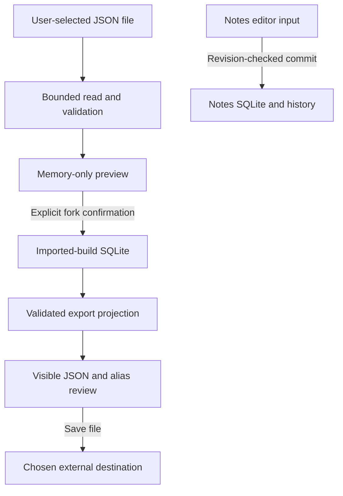

# Apple #98: Data inventory, threat model and mitigation register

Prepared 2026-10-18 for [Apple #98](https://github.com/Pick-Your-AI/pick-your-ai-apple/issues/98).
Independent security/privacy engineering review of this record and its inspected
source boundaries was supplied on that date with no blocking finding. Device and
service qualification remain unresolved. The record does not establish service
authorization, secure erasure or production release.

## Exact reviewed scope

| Source | Included behavior | Delivery and execution boundary |
| --- | --- | --- |
| Signed main `63b4475106b9125c0c9109ece9e648a9ff83000b` | Local notes editor/history; SQLite drafts; frozen build transfer and comparison; independent public catalog/cache/transport packages | App and package code are delivered. Catalog, service, comparison and transfer packages are not thereby wired into the main app. Main native tests, transfer tests and catalog tests below were directly inspected. |
| [PR #166](https://github.com/Pick-Your-AI/pick-your-ai-apple/pull/166), head `605a23581da87c10055f5364bc360cc17d55676e` | Separate imported-build library, bounded Files preview, confirmed independent fork, reviewed JSON export, independently available databases and asynchronous startup | Reviewed candidate, with successful native job below; not treated as main delivery. Its older base has ten notes-model tests while main has seventeen. Final integration must preserve main's later history/deferred-save behavior as well as the candidate. |
| [Platform decision](../decisions/issue-22-platform.md), [scope disposition](../decisions/foundation-disposition.md), [account decision](../decisions/issue-24-accounts.md) | SwiftUI, iPhone/adaptive iPad, iOS/iPadOS 17 floor; guest local planning; accounts, runtime execution and extra platforms remain disabled/deferred | The simulator preview bundle ID is `invalid.pickyourai.localpreview`. No production app identity, signing team, endpoint, account operator or release authority is inferred. |

The issue was open and unassigned when refreshed for this assessment. The receiving
roles below are required responsibilities, not invented human assignees. References
to a future integration describe requirements, not an invented deployed service.

## Assets and retention

| Asset | Entry and representation | Retention and disclosure boundary |
| --- | --- | --- |
| Notes title and workload text | User input; `EditorPayload` version 1 with title separate from JSON notes | Memory while editing; acknowledged revisions in `LocalDrafts/drafts.sqlite`. History retains earlier text until the draft is explicitly deleted. Unsaved changes may be lost on process termination. No remote upload is wired. |
| Draft identity and history metadata | Locally generated UUID, revision, restoration source | SQLite head/history and retired-ID table. `SceneStorage` retains the selected UUID, not a serialized draft. UUIDs are routing metadata, not access credentials. |
| Imported build bytes (candidate #166) | One user-selected JSON file; bare frozen-v1 build or the existing web export envelope | Preview in memory only; explicit confirmation persists a version-1 local wrapper in separate `imported-builds.sqlite`. The wrapper retains the forked snapshot and untrusted synthetic/source-revision metadata. Read-only presentation does not make the bytes public or establish ownership. |
| Build settings, objectives and public alias | Schema-supported free text and typed values; explicit alias before export | An allowed field can still contain private workload information or a secret typed as ordinary text. The exact projected export is shown for review. There is no general secret detector. |
| Prepared export and exported file | Projection strips original owner references, notes and extensions, validates again, then substitutes the supplied alias | Prepared bytes remain in memory until cleared. The system file exporter writes only after the disclosure review action. A destination/provider or subsequent recipient controls its resulting copy; local deletion cannot revoke that copy. |
| Catalog/pricebook and provenance | Separate bounded public-artifact transport and synthetic-only atomic cache | Cache is independent of private draft storage and is not connected to the current main app. Digests establish byte consistency, not publisher authenticity, source rights or production promotion. |
| Diagnostics | Typed storage, transfer, runtime and transport errors; visible generic UI notices | Errors omit raw workload, SQL, filesystem paths, response bodies and transport descriptions at the inspected boundaries. This does not establish what OS crash reports, external providers or future SDKs collect. Never attach user databases/imports to public issues. |
| Tokens and account identity | No active account/sign-in/private service path | No token storage or Keychain lifecycle has been implemented for an active account flow. This is an absent capability, not evidence that token revocation/deletion has passed. |

The inspected app creates Application Support storage with
`FileProtectionType.completeUntilFirstUserAuthentication`. This class selection is
source evidence only. Existing-file attributes, temporary journal protection,
backup behavior, app-switcher snapshots, clipboard use and locked-device behavior
have not been qualified. There is no configured backup exclusion or explicit
database secure-erasure mechanism in the inspected composition.

## Trust boundaries and sensitive-text trace



The imported branch is the exact #166 candidate. The diagram does not imply a
connection from notes to export, a remote share endpoint or production catalog
activation. Those boundaries must be implemented and reviewed separately.

1. A file provider supplies an untrusted URL and content. Candidate
   [ImportedBuildLibraryModel](https://github.com/Pick-Your-AI/pick-your-ai-apple/blob/605a23581da87c10055f5364bc360cc17d55676e/Packages/PlannerUI/Sources/PlannerUI/ImportedBuildLibraryModel.swift)
   obtains security-scoped access for a regular file, reads in chunks with an
   independent 512 KiB actual-byte limit, and closes the handle/grant. Cancellation
   is checked during reading and before preview publication. Advertised file size
   is not trusted. A valid preview has no write or network authority.
2. [BuildTransfer](../../Packages/PlannerTransfer/Sources/PlannerTransfer/BuildTransfer.swift)
   and the bounded [JSON parser](../../Packages/PlannerTransfer/Sources/PlannerTransfer/JSONValue.swift)
   reject oversized, excessively nested/complex, duplicate-key, unsupported and
   schema-invalid input. The import guard rejects named private fields, normalized
   credential-like keys and `secret://` references without echoing them. A schema
   URI is data; it is not permission to navigate or fetch it.
3. Explicit import confirmation replaces the source build ID/owner with newly
   generated local identities and revision 1, retaining the version locks. The
   exact serialized fork is revalidated before storage, including the byte bound.
   The source ID never becomes a save/update authorization target. Neither the
   source file nor an existing notes draft is modified by preview or rejection.
4. [DraftStore](../../Packages/PlannerData/Sources/PlannerData/DraftStore.swift)
   binds values in SQL, limits payloads to 1 MiB and titles to 1,024 UTF-8 bytes,
   serializes writes, and commits a revision only with the expected prior revision.
   Rename/restoration append history. Failed transactions/migrations roll back;
   unknown schema and corruption do not trigger destructive reset. A durable
   acknowledgement describes the committed bytes, not later input still in memory.
5. Export recursively removes notes, extensions and original owner references,
   inserts the explicit public alias, rejects remaining known private/credential
   fields and validates the final result. Candidate
   [ImportedBuildLibraryView](https://github.com/Pick-Your-AI/pick-your-ai-apple/blob/605a23581da87c10055f5364bc360cc17d55676e/Packages/PlannerUI/Sources/PlannerUI/ImportedBuildLibraryView.swift)
   shows those exact bytes and requires an explicit disclosure review before the
   file exporter. Alias or selection changes invalidate preparation. Synthetic
   envelope metadata remains marked; an unmarked import remains unqualified.
6. Confirmed notes deletion removes only the chosen current draft/history and
   records its retired UUID to reject delayed recreation. Stale revisions and
   failed deletes retain the original record. This is logical application deletion,
   not guaranteed physical erasure of SQLite pages, journals, backups or exported
   copies. Candidate #166 has no imported-build deletion UI yet; that gap is T05.

## Threats, controls and verification tasks

An owner column identifies the existing receiving work package and required role.
It does not invent a human assignee. A control with a passing synthetic regression
remains open where the stated device/service/flow evidence is absent.

| ID / threat | Inspected control and observed evidence | Remaining task, acceptance boundary and responsible role |
| --- | --- | --- |
| T01 — Malicious file exhausts memory, introduces incompatible data or reveals a diagnostic secret | Parser byte/depth/node limits, escaped duplicate-key detection, strict version/schema boundary and typed errors. `testMaliciousBoundariesAndRedactedErrors`, `testResourceAndPrivateInfrastructureLimits` and `testInvalidAndOversizedFilesCannotCreateRows`; E1/E4 below. | [#82](https://github.com/Pick-Your-AI/pick-your-ai-apple/issues/82)/[#102](https://github.com/Pick-Your-AI/pick-your-ai-apple/issues/102), Apple import/privacy reviewer: replay real Files-provider cancellation, deceptive metadata and unsupported payloads, verify no row change and no input echo. Provider/device evidence remains unverified. |
| T02 — Claimed import owner/ID overwrites another local draft | Preview cannot write; explicit confirmation creates distinct wire/storage IDs and local owner. `testPreviewAndCancelNeverWriteStorage`, `testConfirmedForksNeverReuseSourceOrLocalIdentity`, `testEmptyAutosaveSurvivesRejectedExportAndStoreReopen`; E1/E4. | #82/[#84](https://github.com/Pick-Your-AI/pick-your-ai-apple/issues/84), Apple storage/sharing reviewer: preserve separation in the final main integration, then verify a native round trip with an existing unsaved note and two imported forks. No live share authority is established. |
| T03 — Export leaks private infrastructure, workload text or an original owner | Known-field projection, explicit alias, post-projection validation and exact JSON disclosure review. `testPrivateProjectionAndSecretReferences`, `testExportRequiresAliasAndDoesNotExposeLocalOwner`; E1/E4. | #82/[#99](https://github.com/Pick-Your-AI/pick-your-ai-apple/issues/99), privacy reviewer: exercise every exported free-text path and provider destination. Allowed names/objectives/settings may be sensitive; do not claim filtering detects arbitrary secrets or revokes recipients' copies. |
| T04 — Concurrent/stale operation or storage failure loses acknowledged work | SQLite transactions/CAS, non-destructive migration/corruption handling, append-only restoration and retired IDs. Actual abrupt-exit and disk-capacity regressions; E2. Main model preserves edits arriving during save/restore and drains queued lifecycle saves; E3. | [#69](https://github.com/Pick-Your-AI/pick-your-ai-apple/issues/69)/[#86](https://github.com/Pick-Your-AI/pick-your-ai-apple/issues/86), Apple storage/lifecycle reviewer: actual process interruption during UI autosave, upgrade and low-resource qualification. Unacknowledged in-memory edits remain at risk. Preserve main's newer history behavior when integrating #166. |
| T05 — User cannot remove retained imported private content | Notes have confirmed scoped CAS deletion; storage supports transactional deletion and rollback. Candidate imported-build UI exposes no delete action. | [#80](https://github.com/Pick-Your-AI/pick-your-ai-apple/issues/80)/#99, Apple library/privacy reviewer: add explicit imported-fork deletion, invalidate selection/prepared export/comparison state, retain unrelated rows and source files, test stale/failing deletion and restart. Open implementation finding; not solved by uninstall advice or a read-only label. |
| T06 — Local disclosure through files, backups, UI snapshots or copied text | App-owned Application Support directory and selected protection class; no secrets added to diagnostics. | #99/[#101](https://github.com/Pick-Your-AI/pick-your-ai-apple/issues/101), device/privacy reviewer: inspect all database/journal attributes, first-unlock/relock behavior, backup/restore, app-switcher and clipboard/export paths on supported physical devices. Define the retention/backup policy and validate the release binary. No accountable device recipient or physical evidence is recorded here. |
| T07 — File deletion is misrepresented as erasure or remote revocation | Draft deletion removes app-visible head/history and retains a non-payload retired UUID. It sends no remote request. | #99/[#100](https://github.com/Pick-Your-AI/pick-your-ai-apple/issues/100), privacy/service reviewer: distinguish local logical deletion, secure-erasure policy, file-provider copies and service revocation. Service/account deletion is conditional and unavailable, so it cannot be reported complete from local hiding. |
| T08 — Synthetic, tampered or stale artifacts become trusted/current facts | Catalog cache validates complete pair pins/digests via a required validator, refuses production mode and preserves the previous release on failure. `testProductionRejectsEvenEmptyCacheAndEmptyManifest`, cancellation/tamper/immutable-version tests; E5. Imported synthetic labels persist; current checks remain unknown. | [#31](https://github.com/Pick-Your-AI/pick-your-ai-apple/issues/31)/[#39](https://github.com/Pick-Your-AI/pick-your-ai-apple/issues/39)/[#40](https://github.com/Pick-Your-AI/pick-your-ai-apple/issues/40)/[#87](https://github.com/Pick-Your-AI/pick-your-ai-apple/issues/87), catalog/privacy reviewer: connect a full canonical validator and accepted source-use/promotion receipts to actual UI/cache integration. Hashes and research merge alone must never authorize real-data promotion. |
| T09 — Public download redirects private context or accepts partial content | [PublicArtifactClient](../../Packages/PlannerCatalog/Sources/PlannerCatalog/PublicArtifactClient.swift) uses HTTPS exact host/port, no userinfo/query/fragment, refuses every redirect, bounds actual bytes, disables shared cookies/credentials/cache and returns redacted errors. Eight Apple URLSession regressions pass; E5. | [#44](https://github.com/Pick-Your-AI/pick-your-ai-apple/issues/44)/#99/[#106](https://github.com/Pick-Your-AI/pick-your-ai-apple/issues/106), transport/service reviewer: use only a configured authorized public origin, validate TLS/staging and OS cancellation. Exact origin matching is not an IP/SSRF sandbox, publisher authentication or private API authorization. |
| T10 — Crafted link, expired share or another identity mutates/discloses private state | No Universal Links handler, associated-domain entitlement, private API, share revocation or account UI is active in the assessed app. Read-only package values confer no server authority. | [#48](https://github.com/Pick-Your-AI/pick-your-ai-apple/issues/48)/[#50](https://github.com/Pick-Your-AI/pick-your-ai-apple/issues/50)/[#83](https://github.com/Pick-Your-AI/pick-your-ai-apple/issues/83)/[#85](https://github.com/Pick-Your-AI/pick-your-ai-apple/issues/85)/#102, canonical service and Apple routing/privacy reviewers: obtain the accepted origin/authorization contract, enforce revocation/private reads server-side, and replay crafted/expired/revoked routes with an unsaved local draft. Absent features are not successful adversarial tests. |
| T11 — Build/test artifacts or future SDKs disclose private data or credentials | Inspected workflows run synthetic fixtures, read-only contents permission, checkout without persisted credentials and no signing secrets. Native evidence artifact retention is fourteen days. | [#30](https://github.com/Pick-Your-AI/pick-your-ai-apple/issues/30)/#101/[#103](https://github.com/Pick-Your-AI/pick-your-ai-apple/issues/103)/[#110](https://github.com/Pick-Your-AI/pick-your-ai-apple/issues/110), CI/privacy/release reviewer: continue synthetic-only public artifacts, inspect untrusted-PR behavior and signed release dependency/network/privacy inventory. No production binary or credential-rotation drill is claimed. |

## Execution receipts and reproduction

These are observed successful jobs, not inferred green checks. Logs were directly
inspected for the named suites, actual toolchain and result. All inputs are synthetic.
No Swift/Xcode execution occurred in the Linux document-review workspace.

| Evidence | Immutable input and observed execution | Limits |
| --- | --- | --- |
| E1 — Transfer/parser/privacy projection | Main `63b4475106b9125c0c9109ece9e648a9ff83000b`; [run 39094864310 / job 117579091278](https://github.com/Pick-Your-AI/pick-your-ai-apple/actions/runs/39094864310/job/117579091278). Xcode 16.4 build 16F6, Swift 6.1.2; four pinned source hashes, 129 Python reference cases, 24 Swift tests (11 transfer, 12 comparison, one durable transition), zero failures; unsigned iOS Simulator SDK build succeeded. | Package tests and SDK compile, not native Files interaction or a real-data/share receipt. |
| E2 — Durable storage, interruption and diagnostic redaction | Tested storage `96470f2ec60516ad668a546eecbe2825fc8689de`; [run 39089657213 / job 117563489464](https://github.com/Pick-Your-AI/pick-your-ai-apple/actions/runs/39089657213/job/117563489464). Twenty-five host tests, actual abrupt exit after history write/before commit/during migration, and twenty-five tests on each pinned iPhone SE (3rd generation)/iPad (10th generation), iOS 18.5; both simulator test results succeeded. Artifact `12122975406`. | Not hardware power loss, physical-device protection, backup or secure erasure. Main DraftStore source SHA-256 is the same `19bdb1e82ef64574f7eeed7c85c681a8f3ca16b52472bdd04903b0124a406f14`. |
| E3 — Delivered notes model | Main `63b4475106b9125c0c9109ece9e648a9ff83000b`; [run 39094864284 / job 117579091301](https://github.com/Pick-Your-AI/pick-your-ai-apple/actions/runs/39094864284/job/117579091301). Seventeen actual SQLite-backed model tests, zero failures; unsigned app build and iPhone 17 Pro/iPad Pro 13-inch (M5) launch smoke on iOS 26.2 succeeded with Xcode 16.4/16F6 and Swift 6.1.2. | Launch smoke does not exercise UI taps, accessibility, termination during a save or physical-device behavior. |
| E4 — Candidate Files/startup models | #166 head `605a23581da87c10055f5364bc360cc17d55676e`; [run 39092564697 / job 117572205908](https://github.com/Pick-Your-AI/pick-your-ai-apple/actions/runs/39092564697/job/117572205908). Twenty-five tests: ten older notes tests, seven imported-build tests, six startup tests, two independent-corrupt-store tests; zero failures. Xcode 16.4/16F6, Swift 6.1.2, unsigned app build and iPhone 17 Pro/iPad Pro 13-inch (M5), iOS 26.2 launch smoke succeeded. Artifact `12124900177`. | Candidate execution only; final main integration must preserve E3 behavior and satisfy its checks. Security-scoped third-party provider journeys and imported-build deletion are not covered. |
| E5 — Public cache/transport | Main `63b4475106b9125c0c9109ece9e648a9ff83000b`; [run 39094864303 / job 117579091194](https://github.com/Pick-Your-AI/pick-your-ai-apple/actions/runs/39094864303/job/117579091194). Xcode 16.4/16F6, Swift 6.1.2; seventeen cache, eight search and eight public-transport tests, all 33 passed; unsigned iOS Simulator SDK build succeeded. | Controlled URLProtocol transport and synthetic cache data, not staging/TLS, device traffic or accepted production content. |

Reproduce the package boundaries on the pinned macOS/Xcode toolchain:

```sh
swift test --package-path Packages/PlannerTransfer
swift test --package-path Packages/PlannerData --scratch-path .build-storage -Xswiftc -warnings-as-errors
python3 tools/storage/crash_replay.py .build-storage/debug/DraftCrashProbe
swift test --package-path Packages/PlannerUI
swift test --package-path Packages/PlannerCatalog
```

The transfer [reference verifier](../../Packages/PlannerTransfer/Tools/verify_contract.py)
requires `jsonschema[format]==4.26.0`. The exact repository workflows retain toolchain
checks and SDK builds; running package tests alone does not reproduce those builds.
Use the candidate ref for E4 and the listed delivered refs for the other receipts.
Do not attach private workload files or actual user database snapshots as fixtures.

## Receiving disposition and completion boundary

| Exact #98 criterion | Result supplied by this record | Remaining disposition |
| --- | --- | --- |
| Reviewed threat model maps risks to concrete verification tasks. | Independent security/privacy engineering review supplied on 2026-10-18 with no blocking finding. Eleven scoped threats map inspected controls to executable remediation/retest tasks and existing work packages. | Affected service review remains necessary when that service boundary exists. Device/provider/service qualification is not supplied by the engineering review. |
| Trace sensitive workload text through import, storage, diagnostics, sharing and deletion; identify trust boundaries, mitigation evidence and unowned residual risks. | Asset/retention inventory and six-step trace cover delivered local paths and identify candidate Files paths explicitly. T05 is a concrete deletion gap; T06/T07/T10 record unqualified device/erasure/service boundaries and unfilled receiving roles. | Retest actual provider/device/service scenarios as their implementations become available. Unexecuted scenarios remain unverified and open findings stay open. |
| The data inventory, threat model and mitigation register is linked with criterion results, exact versions, limitations and receiving-review disposition. | This named output, E1–E5 immutable inputs/results, reproduction commands and per-criterion disposition are supplied. | Link the reviewed merged record from #98; retain final commit/review identity. Publication alone does not close #98 or its dependent security/device/service issues. |

Update this record when a trust boundary changes, a finding is remediated, or the
main app gains a previously separate adapter. Close a finding only after a test
replays the failure and recovery at the actual changed commit. A successful local
delete, synthetic test or unsigned simulator build must never be promoted into a
server, physical-device or production-release claim.
