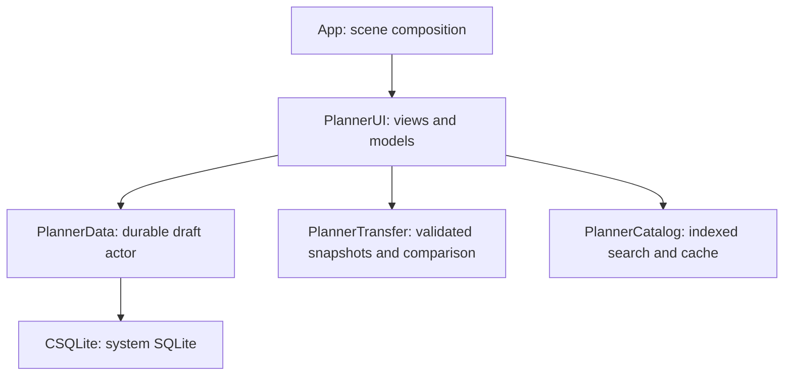

# Current modules and asynchronous publication boundaries

This is a source inventory for [Apple #29](https://github.com/Pick-Your-AI/pick-your-ai-apple/issues/29),
prepared with the [comparison worker follow-up](comparison-preparation.md) against
the catalog/editor [#240 candidate](https://github.com/Pick-Your-AI/pick-your-ai-apple/pull/240)
at `c8fa65c79b7f02a39f5a03e85a69a81d4d4d2694`, tree
`99ab352371ff44028ad15851b01e33df66ca7022`, which retains canonical #198
`8e76d0ee` through reviewed fixture checkpoint `10cd075c`. The subsequent
comparison/contract composition retains signed main `9a3b0fe4`,
including its quality-record, bounded-cache and raw-Core-JSON boundaries. It describes implemented target
dependencies and publication guards. It does not treat an unexecuted test, a
package-only boundary, or a proposed follow-up as an accepted application result.

## Implemented module dependency diagram

An arrow means that the production target imports or links the target at its end.
The diagram follows the checked-in package manifests and app entry point retained
through those carries; it does not infer a production dependency from a test dependency.

| Target | Current responsibility and dependency evidence |
| --- | --- |
| App | [PlannerApp.swift](../../App/PlannerApp.swift) imports SwiftUI and PlannerUI, opens the two local libraries, and composes Notes, Imported builds and Demo catalog tabs. App-owned directory/file protection is supplied through the startup factory. |
| PlannerUI | [Manifest](../../Packages/PlannerUI/Package.swift) links PlannerData, PlannerCatalog and PlannerTransfer. Views and observable models use the main actor for user-visible state; storage, catalog lookup and substantial snapshot preparation cross asynchronous boundaries described below. |
| PlannerData | [Manifest](../../Packages/PlannerData/Package.swift) links CSQLite. The storage actor owns revision transactions, history and durable deletion. Payload semantics are supplied by callers; the current production target does not import PlannerCore, PlannerTransfer or SwiftUI. |
| PlannerTransfer | [Manifest](../../Packages/PlannerTransfer/Package.swift) has a PlannerData package dependency for its real-storage **test target**. Its production target has no PlannerData target dependency. It validates immutable build inputs and performs projection/comparison without owning the UI or database. |
| PlannerCore | [Manifest](../../Packages/PlannerCore/Package.swift) declares an independent domain target. Runtime configuration and AnalysisStore are prepared domain boundaries; this app entry point does not yet connect them to a service or analysis screen. |
| PlannerCatalog | [Manifest](../../Packages/PlannerCatalog/Package.swift) declares a target without sibling package dependencies. PlannerUI's bundled preview source uses its search index and retains exact catalog/item pins through typed details. The disk-cache API remains a package boundary; this preview screen does not establish a production cache, catalog service or source-use authority. |

The accepted [platform ADR](../decisions/issue-22-platform.md) supplies the module
separation and dependency-direction policy. Its original App/Core/Data description
is a design boundary, not evidence that every planned adapter has been implemented.
The current payload-agnostic storage module and the additional UI/Transfer/Catalog
packages above are the source inventory for this implementation. No server,
catalog publisher, shared service, transport endpoint or pricing authority is
created by these local packages.

## Execution and publication ownership

| Operation | Work executor and capture | Acceptance or invalidation boundary |
| --- | --- | --- |
| Library startup | [LocalLibraryStores](../../Packages/PlannerUI/Sources/PlannerUI/LocalLibraryStores.swift) prepares the directory and synchronously opens/migrates SQLite inside a detached worker. | [LocalLibraryStartup](../../Packages/PlannerUI/Sources/PlannerUI/LocalLibraryStartup.swift) checks caller cancellation and its attempt generation before publishing ready/unavailable state. Cancellation remains loading so a later appearance can retry; a ready scene retains its opened stores. |
| Draft save and history | [DraftLibraryModel](../../Packages/PlannerUI/Sources/PlannerUI/DraftLibraryModel.swift) captures the selected identity and dirty input on the main actor, then awaits the independent DraftStore actor. | Store compare-and-swap revisions establish the committed record. Model guards preserve edits made during reads/writes, keep the original identity when an open is invalidated, and drain a queued lifecycle save with the latest input. The production autosave delay remains 750 ms. |
| Imported Files/data preparation | [ImportedBuildLibraryModel](../../Packages/PlannerUI/Sources/PlannerUI/ImportedBuildLibraryModel.swift) uses its detached preparation boundary for bounded reading, decoding, preview and export. Export intent is captured synchronously before the returned task can queue. | The worker result is inspected for caller cancellation before success or failure is unwrapped. Main-actor publication also checks cancellation and the relevant operation generation/selected local row/revision. Ending a Files security grant does not grant the imported bytes any authority. |
| Imported library mutation | The same model prepares immutable data outside the main actor and awaits the store actor for exact transactions. | A prepared duplicate carries its expected source revision into the atomic transaction. Adoption and operation generations govern the displayed selection; validation or transaction rejection preserves existing rows and unrelated data. |
| Catalog browse and details | [BundledCatalogPreviewSource](../../Packages/PlannerUI/Sources/PlannerUI/BundledCatalogPreviewSource.swift) is a separate actor that qualifies the exact synthetic fixture, decodes its snapshot and queries the PlannerCatalog actor. | [CatalogBrowserModel](../../Packages/PlannerUI/Sources/PlannerUI/CatalogBrowserModel.swift) binds pages to the current request and filters. [CatalogDetailsModel](../../Packages/PlannerUI/Sources/PlannerUI/CatalogDetailsModel.swift) additionally requires its active request and complete selected row/catalog identity before publication. Dismissed detail actions and cancellation-ignoring late results are rejected; source declarations do not acquire evidence or pricing authority. |
| Configuration comparison | [ImportedBuildPreparation](../../Packages/PlannerUI/Sources/PlannerUI/ImportedBuildPreparation.swift) runs the canonical BuildComparison function through the same detached boundary. The model captures both snapshots, qualifications and selected local row/revision before queueing. | A separate comparison generation owns publication and cleanup. Changing the selection or baseline rejects late outcomes; cancelled N cannot clear a pending N+1 request. Only a committed deletion clears the affected baseline pin. The canonical algorithm, private-field redaction and both sides' qualifications remain intact. |
| Domain analysis requests | [AnalysisStore](../../Packages/PlannerCore/Sources/PlannerCore/AnalysisStore.swift) is an actor that accepts results for exact build/revision/version-lock identities and a fresh request generation. It does not execute transport. | A result must carry validated response identity and the original active request. Retry, selection changes, cancellation, clear and disconnect reject stale callbacks. This is a package boundary until a native adapter/screen actually uses it. |

Cancellation asks a worker to stop; generation and revision checks decide whether
its outcome still belongs to the screen. The latter remain necessary when a
synchronous worker or external callback ignores cancellation. A completed write
is a durable event even if a subsequent library refresh fails, so storage failure,
action failure and comparison notices cannot be substituted for one another.

## Required regression and receipt map

| Requirement | Checked-in cases or record | Evidence limit at the recorded source |
| --- | --- | --- |
| Main-actor work proceeds while SQLite startup is held | [Startup tests](../../Packages/PlannerUI/Tests/PlannerUITests/LocalLibraryStartupTests.swift): `testMainActorProcessesEditorActionWhileStartupOpenerIsBlocked`, cancelled/superseded-attempt and retry cases | Uses a real selected draft and bounded worker hold. These cases passed within the actual 68-case `460f9a` model execution. Its iPad journey passed and iPhone history reveal failed; neither result is a startup timing benchmark or physical-device measurement. |
| A stale read cannot change the selected draft or lose a lifecycle save | [Editor model tests](../../Packages/PlannerUI/Tests/PlannerUITests/DraftLibraryModelTests.swift): `testEditsDuringOpenKeepOriginalDraftAndUnsavedInput`, `testLifecycleSaveDuringOpenPersistsLatestEditsToOriginalDraft`, save/restore/history races | Controlled tests disable only their own autosave scheduler to isolate the read. The actual UI journey uses the unchanged production timer and durable reopen assertions. |
| Preview/export stay responsive and cancellation wins over a late success or validation error | [Import preparation record](import-preparation.md) and [imported-library tests](../../Packages/PlannerUI/Tests/PlannerUITests/ImportedBuildLibraryTests.swift) | All six worker cases within 20 imported-library cases executed successfully in the 68-case `460f9a` run after public enum-case correction. The prior inaccessible-helper compilation failure remains recorded. This package execution does not establish a full Files/share UI journey. |
| Revision N cannot overwrite N+1, including same-revision retries | [AnalysisStore tests](../../Packages/PlannerCore/Tests/PlannerCoreTests/AnalysisStoreTests.swift): `testThreeRevisionsCompleteOutOfOrder`, `testSameRevisionRetryHasNewGeneration`, `testLateCancelAndFailureCannotEraseNewResult`, `testCancelledTaskCannotPublishAfterRetry` | These exercise the actual domain actor and deliberately late outcomes. They do not establish a connected app transport or comparison worker. |
| Comparison N cannot overwrite N+1 or clear its pending work | [Comparison preparation record](comparison-preparation.md) and the nine new imported-library cases, including both completion orders, late worker errors, explicit cancellation and baseline deletion | The controlled worker cases use real saved snapshots and a responsive notes editor. They are declared source at this checkpoint; no local Swift execution or measured latency is claimed. |
| Catalog selection survives retry and late results cannot replace it | [Catalog browser tests](../../Packages/PlannerUI/Tests/PlannerUITests/CatalogBrowserModelTests.swift), [detail tests](../../Packages/PlannerUI/Tests/PlannerUITests/CatalogDetailsModelTests.swift) and [receiving record](catalog-editor-receiving.md) | Exact filters, catalog release, item/version, source qualification, dismissed detail actions and late cancellation-ignoring results remain covered by the received cases. Their own historical execution and failed kind-switch/UI receipts do not qualify this changed composition. |
| Exact toolchain, complete model execution, both UI destinations and cleanup | [Editor integration receipt](editor-integration.md), [toolchain record](toolchain-pin.md), and [native workflow](../../.github/workflows/native-ui.yml) | The received `29c91f0d` catalog/editor source declares 87 model cases; this comparison follow-up declares 96 with 47 required class-qualified identities. Its accepted-main quality carry requires 57 Transfer cases and 21 named identities; the earlier 48-case profile remains scoped to its historical source. Each delivery needs its own fresh execution and both complete Notes/catalog cases on each pinned iPhone/iPad with zero failures/skips and successful owned-device cleanup. Historical 68/71/80/87 model scopes, destination passes, failed reveals and interrupted attempts remain separate receipts. |

## Criterion disposition

This supplies the required module diagram and connects concrete asynchronous
guards to their tests and evidence records. Receiving review must still assess
the actual published revision and the applicable successful native run; this
source inventory itself contains no new executed native result.

The remaining #29 work includes native execution of this comparison worker, the
separately owned app lifecycle/configuration integration, and the issue's required
supported simulator/device cold-start, backgrounding, cancellation and
invalid-configuration journeys. The current local app has no service transport;
future adapters must use the governed service boundary and provide their own
identity/cancellation evidence. That future integration is not credited to these
package tests. Physical-device responsiveness and accessibility are not measured
by deterministic package probes. Preserve missing or failed evidence explicitly
when reconciling #29; this document does not close the issue.
